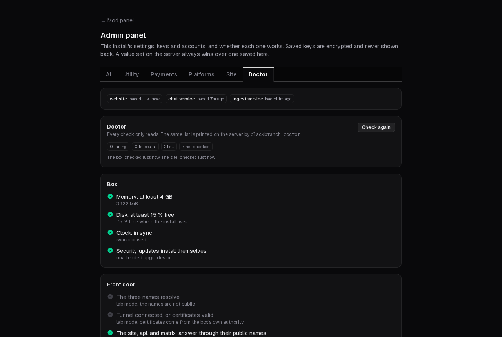

<p align="center"></p>

# Black Branch

Black Branch is a home for a streamer's community that the streamer owns: one website with live
chat that brings Twitch, YouTube, Kick and Streamplace chat together with the site's own, a
community chat server (Matrix) with rooms and forums, supporter perks and tips through your own
Stripe and PayPal accounts, moderation tools, alerts for your stream, and a points system. It runs
on **your** server — a small rented Linux server or a Linux box at home — as one Docker bundle that
backs itself up and, installed from a release, updates itself from signed releases. There is no
hosted service and nobody between you and your viewers.

> **Status: preview.** It runs a real community today; installs by other streamers are new. The install
> is meant to be guided enough for someone new to servers; that is a goal, not yet proven — what is
> tested, and what is not there yet, is listed under [known limits](docs/public/install.md#known-limits-of-this-preview).
> Read [install](docs/public/install.md) and [operate](docs/public/operate.md) before you start.

<p align="center">
  
  
</p>

## What it does

- **One chat for every platform:** Twitch, YouTube (reading chat), Kick and Streamplace beside the
  site's own chat. Viewers link the platform accounts they already have.
- **A community server** (Matrix) with your space, rooms, forums and end-to-end encrypted direct
  messages, built into the site.
- **Supporters and tips** through your own accounts: card payments and memberships through Stripe,
  tips through PayPal and Venmo, and alerts for Ko-fi, Patreon and Streamlabs.
- **Points** under a name you choose, a store, badges and a leaderboard.
- **Moderation:** bans and timeouts that reach the platforms where they allow it, reports, a mod log,
  link rules, automatic moderation and a lockdown switch for raids.
- **On stream:** alerts, read-aloud, polls and stickers as OBS browser sources, and OBS scene control
  through one browser source that works from any network.
- **Running it:** nightly backups with a weekly restore test, a doctor that checks every part with a
  one-line fix for each red row, and an Admin Panel for every setting.

Everything optional is a module, off until you switch it on.

## Docs

- [Install](docs/public/install.md) — from an empty server to a running site, every setup page.
- [Operate](docs/public/operate.md) — backups and restores, updates, password resets, moving servers.
- [Platforms and payments](docs/public/platforms/README.md) — what to register at each one.
- [Changelog](docs/public/changelog.md) — what each release changed.

## What you need

- **A Linux server**: Debian stable or Ubuntu LTS on x86-64, with at least **4 GB of memory, 2 CPU
  cores and 40 GB of disk** (8 GB of memory is comfortable). A rented VPS or a machine at home.
- **An account on it that can use `sudo`.** You do not need to sign in as root; the installer runs
  with `sudo` from your ordinary account.
- **A domain** you control (`example.com`). The site answers there, and on `api.example.com` and
  `matrix.example.com`. The domain is permanent for the install: the chat server is named after it.
- **A way in from the internet**, one of:
  - a free **Cloudflare** account with the domain on it (the default — no open ports, works behind a
    home router), or
  - a server with a public address and ports **80 and 443** open (the box gets its own certificates).
- For each streaming platform and payment provider you use, an account there; the setup pages walk
  you through registering your own app at each one ([platform pages](docs/public/platforms/README.md)).

## Install

On the server, signed in as your ordinary user:

```bash
curl -fsSL https://blackbranch.app/install.sh | sudo bash
```

Until the first stable release, this installs the beta. It fetches the newest preview release, checks it against the checksum written into the script, and
runs the installer from it (read a script before you pipe it into a root shell). It asks two
questions — the domain, and Cloudflare tunnel or direct — then installs Docker if it is missing,
generates every secret, downloads the site's prebuilt image and starts everything. It ends by
printing **one setup link**: open it in a browser and the setup pages take you through the rest (your
admin account, the recovery sheet, your site's name, the modules, your platforms and payments, your
community's rooms and your backups). The whole path, with every page: [docs/public/install.md](docs/public/install.md).

Previews are published on the **beta** release channel, and a server installed this way follows it.
Every release is signed; the list is at <https://blackbranch.app/releases>.

**From a clone of this repository instead** (then `sudo ./install/install.sh` in it), the server builds
the site's image itself, which needs more memory ([install, section 1](docs/public/install.md#1-before-you-start)),
and follows the **stable** channel, which has no release yet: run `sudo blackbranch update --channel beta`
to receive previews.

## Running it

After setup the box backs itself up every night, checks every week that the newest backup restores,
and applies security releases at a quiet hour (never while you are live). Feature releases wait for
your button. The everyday commands, on the server:

```bash
sudo blackbranch status     # what runs, which release, the last backup and update check
sudo blackbranch doctor     # check every part; each red row has a one-line fix
sudo blackbranch backup     # back up now
sudo blackbranch update     # read the release feed; apply a newer release (asks first)
```

Restores, rollback, password resets and moving to a bigger server: [docs/public/operate.md](docs/public/operate.md).

## Known limits

The site sends no email yet; YouTube chat is read, not posted to; the Discord bridge comes later; and
neither front door (tunnel or direct) has been rehearsed end to end on a fresh public server by the
project. The full list: [install — known limits](docs/public/install.md#known-limits-of-this-preview).

## Getting help

- **Setup help** and **bug reports**: open an issue here — the templates ask for what helps
  (`sudo blackbranch doctor --report` writes a report with no secrets in it).
- **Talk with the team and other streamers** on the project's Discord: <https://discord.gg/uFJbHMbaE>.
- **A paid setup call**: one of the team installs it with you, then you own and run the box. What the
  call covers: [docs/public/setup-call.md](docs/public/setup-call.md).
- **Security problems**: report them privately — see [SECURITY.md](SECURITY.md).

## Contributing

Bug reports and feature requests are welcome now. Code contributions open once the contributor
paperwork is settled — see [CONTRIBUTING.md](CONTRIBUTING.md).

## Support the project

Black Branch is open source with no paid tier. If it is useful to you, you can tip the people who
make it: <https://blackbranch.app/tip>.

## Licence

Black Branch is free software under the GNU Affero General Public License, version 3 only
(`SPDX-License-Identifier: AGPL-3.0-only`); the full text is in [LICENSE](LICENSE). You may run,
study, change and share it. If you run a changed copy as a site other people use, the licence asks
you to offer those people the source of your changed version.
