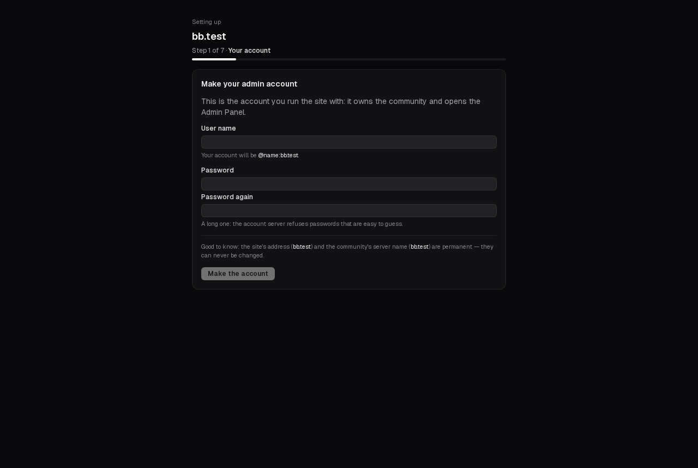
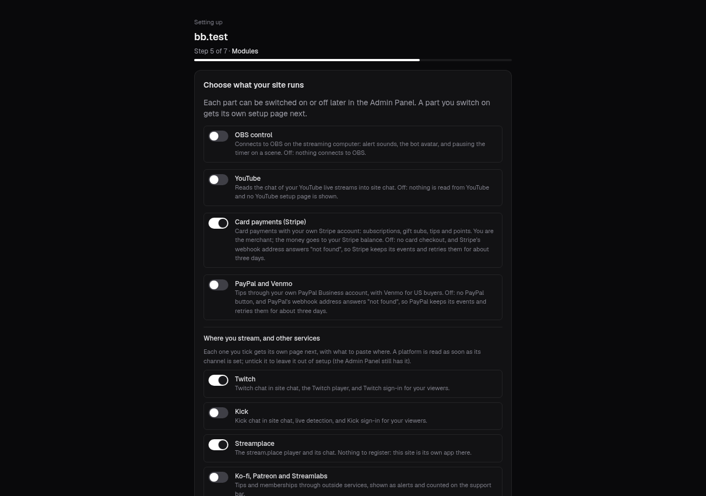
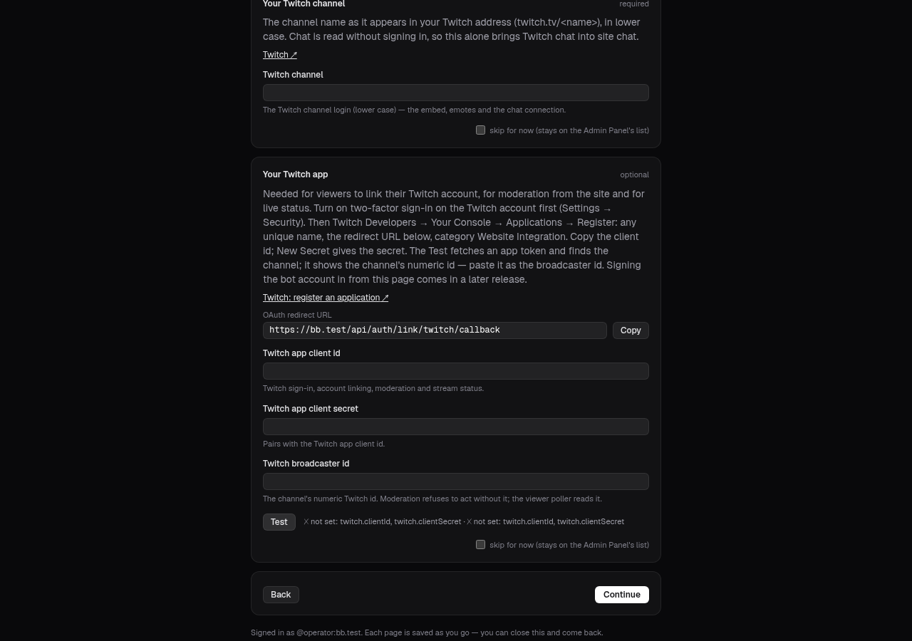

# Installing Black Branch

From an empty server to a running site, in the order you will do it. Plan on about an hour, most of
it on the setup pages registering your apps at Twitch, Stripe and the rest.

## 1. Before you start

**The server.** Debian stable or Ubuntu LTS, x86-64, at least 4 GB of memory, 2 cores and 40 GB of
disk. A rented VPS is the usual choice; a Linux machine at home works the same way. A published
release brings the site as one prebuilt image — the same for every install — so the server never
builds it: a 4 GB server installs with most of its memory to spare (measured: about
1.3 GB in use at the busiest moment of a fresh install, no swap). Installed from a clone of the
repository instead (section 2), the server builds that image itself once,
which takes most of a 4 GB server's memory: a server under about 7.5 GB with no swap then gets a 2 GB
swap file during the install.

**Your account on it.** Sign in as your ordinary user — one that may use `sudo` — and run the
installer with `sudo`, as below. You do not need to sign in as root (signing in as root works too).
Check first: `sudo -v` asks for your password and then says nothing. If it says your user "is not in
the sudoers file", or `sudo` is not found, your account cannot install anything yet: on a rented
server use the account the provider set up for you, or ask them; on your own machine, sign in as root
once and run `apt install sudo` (Debian leaves it out when a root password was set) and
`usermod -aG sudo <your user>`, then sign in again.

The installer checks the box first — before it installs Docker or starts anything — and stops with
the reason if one is wrong: it must be running as root (through `sudo`), on Debian or Ubuntu (it reads `/etc/os-release` and
does not check the release number — Debian stable and Ubuntu LTS are the supported ones), on
x86-64, with about 4 GB of memory or more, able to reach the image registry (ghcr.io answers over
IPv4 only: a server with IPv6 alone needs an IPv4 route out or a NAT64 network). It installs Docker
when the server has none; a Docker already there must have **Docker Compose 2.20 or newer**
(`docker compose version`) — an older one is refused with the update command.

**The domain.** Pick the domain your community will live at — say `example.com`. The site answers
there, the API at `api.example.com`, the chat server at `matrix.example.com`. **The domain is
permanent for this install**: your chat server is named after it, and every account on it ends in
`:example.com`. It cannot be changed later.

**The front door** — how visitors reach the server. Choose one now:

| | Cloudflare tunnel (default) | Direct |
|---|---|---|
| You need | a free Cloudflare account with the domain on it | a public IP address, ports 80 and 443 open |
| Works behind a home router | yes — the server only connects out | no, unless you forward the ports |
| Certificates | Cloudflare's | the server gets Let's Encrypt certificates itself |
| DNS | the installer creates the three records | you point three records at the server first |

## 2. Get the code

The one-line form fetches the newest preview release, checks it against the checksum written into
that copy of the script, and runs the installer from it (section 3; it asks its two questions on your
terminal):

```bash
curl -fsSL https://blackbranch.app/install-beta.sh | sudo bash
curl -fsSL https://blackbranch.app/install-beta.sh | sudo bash -s -- --domain example.com --mode tunnel
```

Read a script before you pipe it into a root shell. Every release so far is a preview, published on
the **beta** release channel; a server installed this way follows that channel. Every release and its
signature are listed at <https://blackbranch.app/releases>.

Or from a clone of the repository, which builds the site's image on the server (section 1):

```bash
git clone https://github.com/Black-Branch/blackbranch.git blackbranch
cd blackbranch
```

A server installed from a clone follows the **stable** channel, which has no release yet. To receive
the previews as updates, run `sudo blackbranch update --channel beta` once setup is done.

## 3. Run the installer

The one-line form runs it for you. From a clone, as your ordinary user, with `sudo` in front:

```bash
sudo ./install/install.sh
```

It asks two questions:

1. **The domain** — `example.com` (no `https://`, no `www.`).
2. **The front door** — `tunnel` or `direct`.
   - **tunnel:** it prints one Cloudflare link. Open it, sign in and pick your domain; the installer
     then creates the tunnel and the DNS records for `example.com`, `api.example.com` and
     `matrix.example.com` itself. If you already made a tunnel in the Cloudflare dashboard, run with
     `--tunnel-token` instead (it asks for the token and does not show it; `--tunnel-token-file <file>`
     reads it from a file) and route the three names to `http://caddy:80` there. Never put the token
     itself on the command line: every account on the server can read it there. A token that is wrong
     stops the install at once with cloudflared's own reason; run the installer again with
     `--tunnel-token` (or `--tunnel-token-file`) and it replaces the token in `.env` — the only thing a
     second run changes there.
   - **direct:** first create three DNS records (`A`, or `AAAA`) for the three names pointing at the
     server. The installer checks they resolve before it continues, and says plainly when one resolves
     to an address that is not this server's (it still finishes: behind a router that forwards ports 80
     and 443 that is expected — otherwise certificates will not issue and the setup link will not open).

You can answer both up front: `sudo ./install/install.sh --domain example.com --mode tunnel`
(`--help` lists every option).

What it does next, without asking: installs Docker Engine if it is missing; copies the release to
`/opt/blackbranch/`; writes `/opt/blackbranch/.env` with a random value for every secret (mode 600,
never printed); downloads the site's image (from a clone: builds it) and builds the other apps' images
on the server; starts the database, the chat server and the site; and waits until every service is
healthy. From a release it took under two minutes on a 2-core, 4 GB test server (most of it downloading
images); from a clone add a minute or two for building the site; a slow connection takes longer. **Running it again changes nothing** — it is safe to repeat after a failure.

It ends by printing **one setup link**:

```
https://example.com/setup?token=…
```

Until setup is finished, every page of your site shows "this site is being set up" to everyone else.

**Keep the link to yourself.** Until your account exists, whoever opens it can make the site's admin
account. Do not paste it into a chat or an issue.

**If the install stops.** Tell the two failures apart by who is speaking:

- **`sudo` itself refuses** — "is not in the sudoers file" or "sudo: command not found" (your account
  may not use sudo: see *Your account on it* in section 1), or "incorrect password attempts" (your own
  password, typed wrong). The installer never started and nothing changed.
- **The installer stops** — a red line that starts with `install:`. It names the reason (the wrong
  system, too little memory, a DNS name that does not resolve, a download that failed…), and many say
  "nothing was changed" or "nothing was installed". Fix that one thing and run the same command again;
  running it again is safe. If the line does not tell you what to do, open a setup-help issue with it.

## 4. The setup pages

Open the link. Each page saves as you go: close the browser and open `https://example.com/setup`
again, and you are back on the same page.



1. **Your account.** A user name and a password, twice. This becomes the site's admin account and
   the streamer's own account on the chat server. You then sign in with it. **The setup link stops
   working once this account exists.**
2. **Recovery sheet.** The backup passphrase, and where `.env` is kept. **Write the passphrase down
   somewhere safe, off the server** — without it no backup can be read, and this page is shown once.
   (`/opt/blackbranch/.env` holds it too; back that file up the same way.) It opens the install's
   backups only: it is not the recovery key each member makes for their own encrypted messages, and
   it cannot unlock those ([operate.md](operate.md#encrypted-messages-what-a-backup-can-and-cannot-give-back)).
3. **Your site.** Its name, short name, the line shown when a link to it is shared, a description,
   the legal details for its terms page (who runs it, a contact address, governing law, the date the
   terms take effect), its time zone and the date its history starts.
4. **Points.** What your community's points are called — the name, the plural, a symbol and an icon —
   and the name of the score on the leaderboard.
5. **Modules.** One switch per optional part (OBS control, YouTube, card payments through Stripe,
   PayPal and Venmo), and below it the platforms you stream on and the other services you use
   (Twitch, Kick, Streamplace, Ko-fi / Patreon / Streamlabs). Everything is off until you choose it;
   all of it can be changed later in the Admin Panel. Which payment provider does what — only Stripe
   takes recurring memberships: [operate.md](operate.md#payments-what-each-provider-does).

   

6. **One page for each part you chose.** Each page says what to do at the provider, with a link
   straight to the right page there, the exact values to paste (computed from your domain — the
   redirect and webhook addresses), the fields to fill, and a **Test** button that checks the values
   work. A page you are not ready for can be skipped; it stays on the Admin Panel's checklist. The
   same instructions, for reading ahead: [platform and payment pages](platforms/README.md).

   

7. **Community.** Creates your community space with its `#general` and `#forum` rooms (the Forums tab's first forum) on the chat server, as your
   own account (so they are yours), and the federation switch — off by default: no other Matrix
   server can reach yours, and yours reaches none. You can switch it on later. And **who can join**:
   *anyone* (open sign-up: viewers make their own accounts) or *only accounts I make* (closed). There
   is no default — the page asks.
8. **Finish.** The quiet hour (when backups and security updates run), whether to send anonymous bug
   reports to the project (off by default), optional **phone alerts** (two private
   [ntfy](https://ntfy.sh) topics, one for urgent problems and one for the rest — both or neither;
   without them important problems still show in the Admin Panel's Doctor), and where backups go: **this server** (simple, but it does
   not survive losing the disk), **a storage bucket** (any S3-compatible one: Backblaze B2, Cloudflare
   R2, Wasabi, Amazon S3…) or **another server over SFTP**. Finish runs a test backup and checks it
   restores before it lets you through; then the site restarts once with your name and points, and
   setup is done.

Until you finish, nobody can sign up on your chat server — your own account is made by page 1. After
that, sign-up follows your answer to *who can join* (the Finish page shows it). To change it later:
Admin Panel → Site → Community server → **Sign-up on the bundled homeserver** → `open` or `closed`.

The setup link expired, or you lost it before page 1? On the server: `sudo blackbranch setup-link`
prints it again while no account exists; `sudo blackbranch setup-link --new` makes a fresh one.

## 5. After setup

- Sign in on your site. The **Admin Panel** (`https://example.com/admin`) holds every setting the
  setup pages wrote, the module switches, the platform and payment guides, **Updates** and the
  **Doctor**.
- Open the **Doctor** (`https://example.com/admin/doctor`, or `sudo blackbranch doctor` on the
  server). Every row should be green; each red one has a one-line fix. Rows for parts you skipped say so.
- Read [operate.md](operate.md): backups, restores, updates, password resets, moving to a bigger server.

## Known limits of this preview

- **Mail:** the site sends no email yet. Sign-up needs no address; a forgotten password is reset on
  the server ([operate.md](operate.md#password-resets)).
- **YouTube** reads chat only; posting into YouTube chat comes later. Viewers cannot link a YouTube
  account to their site account.
- **OBS control** is one browser source, the rig page, which connects out from OBS, so it works from
  any network: the bot's voice and sound alerts, its avatar, scene switching and the timer's pause
  scene. A browser source cannot show or hide OBS's other sources or mute audio; those are not offered.
- **The Discord bridge** comes later.
- **Updates:** releases are published on the beta channel only; the stable channel has none yet. A
  server installed from a clone follows stable until you run `sudo blackbranch update --channel beta`,
  and until then it sees no new release. Your install still works either way.
- **A first install by someone new to servers** is what these pages are written for, but that is
  a goal, not yet proven: no one new to servers has yet installed from them on a fresh machine. What
  is tested on every change is narrower. The project's CI installs from the repository on a fresh Ubuntu 24.04
  machine, with `sudo` from that machine's ordinary account, in lab mode (its own certificates, no
  public domain, no tunnel), checks that every service is healthy and that the setup page and the
  chat server answer, then runs the installer again and checks it changes nothing. It does not go
  through the setup pages or either front door. If something in these pages does not match what you
  see, please open a setup-help issue.
- **The front door:** both tunnel and direct mode are built from the same tested pieces, but neither
  has yet been rehearsed end to end on a fresh public server by the project. If you hit a problem
  there, please open a setup-help issue.
